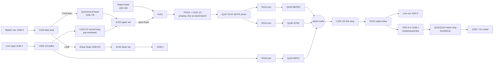

# Tascam 38 REC/PLAY AMPL card - circuit analysis

**Status:** Passes 0-5 of `docs/superpowers/plans/2026-10-13-tascam-38-electrical-analysis.md`
complete. The analysis is complete with open evidence questions: the items
under Open items, several of which (M3, M7) could still be traced further on
these sheets, and the rest of which need the physical machine. This is an
analysis of the existing card, not a replacement design, and nothing here is
a basis for building or powering a replacement card. No state, delay or level
below has been measured on a machine.

**Authority:** `sources/tascam-38-amplifier-schematic.pdf` (channel-1 card,
motherboard, OUT SELECT, FUNCTION, MASTER OSC) and
`sources/tascam-38-transport-schematic.pdf` (power supply and control).
Card contacts are as in `interface-matrix.csv`. The reports behind each
section, with drawing coordinates for every claim, are:

| Topic | Report |
| --- | --- |
| Reproduce, source selection, output, meter feed | `analysis/block-reproduce-output.md` |
| Sync pickup, K101/K103 head switching, K103 drive | `analysis/block-sync-headswitch.md` |
| Line input, record amplifier, bias, erase, meter amplifier | `analysis/block-record-bias-erase.md` |
| Relay coils, mutes, selection-gate drive, FUNCTION override | `analysis/block-control-muting.md` |
| OUT SELECT board: switch poles, K101 / K102 drivers and delays | `analysis/control-outselect.md` |
| FUNCTION board and the REC SIGNAL switch on MASTER OSC | `analysis/control-function.md` |
| Transport sheet: POWER MUTE, PLAY MUTE, REC MODE, REC SIGNAL | `analysis/control-transport.md` |
| Per-contact traces and the independent re-traces | `trace/` |
| Pass 5 independent audits of this document and of the earlier notes | `analysis/pass5-audit-analysis.md`, `analysis/pass5-audit-notes.md` |

Each report separates what the drawing shows from interpretation, and so
does this summary: statements marked *interpretation* are reasoning from the
traced topology, not printed facts.

## Summary

| Measure | Count |
| --- | --- |
| Card contacts (J101-J108) | 50 |
| VERIFIED - card node and motherboard endpoint agreed by two independent traces | 38 |
| UNRESOLVED - no wire drawn on at least one side (11), one disputed junction (1) | 12 |
| CANDIDATE / CONTRADICTED | 0 / 0 |
| Drawing claims spot-checked by the Pass 5 auditor | 25 (24 confirmed, 1 undecidable: M4) |

The card is a full record/reproduce module. One preamp serves both heads;
three JFETs select the monitored source; one FUNCTION line per channel
switches the head to record, enables bias and erase, and overrides the
monitor to INPUT unless REPRO is selected; the output relay K102 doubles as
a power-up and source-change mute. What remains open is listed under Open
items, and the checks that would settle it under Bench verification
checklist.

## Boards and connectors

| Board | What crosses the motherboard boundary |
| --- | --- |
| HEAD PCB | Reproduce, sync and erase head windings and shield returns |
| REC/PLAY AMPL PCB (x8) | Everything on J101-J108; one design for all eight channels |
| IN/OUT PCB | Eight line inputs (P141...) and outputs (P131...) |
| FUNCTION PCB | Per-channel record-ready switches; FUNCTION lines on J174 / J175, buses on J173 |
| OUT SELECT PCB | INPUT / SYNC / REPRO selection on J180 / J181; K101 / K102 drivers |
| MASTER OSC PCB | Bias oscillator to every card on J182; the REC SIGNAL switch Q301 / Q302 |
| MOTHER PCB | Routing and power / control distribution |

Head connectors: channel 1 REPRO P401/J401 to J121/P121, SYNC P402/J402 to
J151/P151, ERASE P403/J403 to J161/P161; channels 2-8 on J122-J128,
J152-J158, J162-J168. The HEAD PCB draws a vertical conductor joining the
shield / return symbols at J401, J402 and J403 - a common head-board shield
network separate from the winding conductors. P121, P151 and P161 have no
printed pin numbers (C20). P172/J172 is a two-contact connector beside
P171/J171 whose identity was not traced. The sheet's note says the schematic
shows one channel except for some components (C10).

P171/J171, the bus between the two sheets (printed names):

| Pin | Signal | Pin | Signal |
| --- | --- | --- | --- |
| 1 | 6V | 7 | 0V |
| 2 | 0V | 8 | 24V |
| 3 | POWER MUTE | 9 | +B(15V) |
| 4 | REC MODE | 10 | -B(-15V) |
| 5 | REC SIGNAL | 11 | 0V |
| 6 | PLAY MUTE | | |

On the card, +B arrives on J105-5, J106-4, J107-3; -B on J103-5, J105-6,
J106-3, J107-4; 24V on J107-2; 0V on J101-1, J104-6, J107-1 and, through the
common bus, J106-5 / -6.

## Devices

From the parts table on the amplifier sheet (around (1980-2900, 1150-1640)):

| Ref | Part | Type / role |
| --- | --- | --- |
| U101 | JRC-4558D-D | dual op-amp: reproduce/sync preamp (1/2), line amplifier (2/2) |
| U102 | RC-4558T1 | dual op-amp: input buffer (1/2), record amplifier (2/2) |
| U103 | listed only as "BIAS AMPL" | bias / erase amplifier; no part number or internals on this sheet |
| Q101, Q103, Q105, Q106, Q107, Q110 | 2SK68AM | N-channel JFET switches |
| Q108, Q111, Q118, Q120 | 2SC1684S | NPN |
| Q109, Q112 | 2SA733P | PNP |
| Q119 | 2SC1318S | NPN |
| D110, D111 | 1N60 | meter rectifier |
| K101, K102, K103 | - | relays; K102 drawn as a reed contact |

OUT SELECT: Q201 / Q203 2SC1684S, Q202 / Q204 2SA720Q, D201-D207 1S2473HJ.

## Block diagram

## Functional blocks

### Reproduce and sync preamp (shared)

- The reproduce head reaches the card on J101-4 (one lead, to K101's fixed
  contact) and J101-3 (other lead, card common bus). The sync head on P151
  reaches it on J106-7 (to K103's upper moving contact) and J106-8 (common
  bus).
- **There is one preamp for both heads.** K101's moving contact feeds
  TR101 pin 1, with an L101 1.2mH + (C101 // C136 470p) trap from that node
  to the bus; then R101 10, R102 220k, into U101 1/2 pin 5. K101 selects
  between J101-4 (reproduce head) and a line from K103's upper fixed contact
  (sync path).
- U101 1/2 feedback: (R104 470k // C103 0.012) in series with (R106 33k //
  C104 270p // [R107 1.5k + switched branches]); shunt leg R103 330 + C102
  100u. The switched branches are R108 5k + Q101 (gated from J103-4, REPRO
  line) and R110 5k + Q103 (gated from J103-2, SYNC line) - separate EQ trims
  for reproduce and sync. *Interpretation:* reproduce equalisation set by
  the 470k // 0.012 network, with mode-specific correction.
- Output: R112 1k, L107/C137//C138 trap, C105 10u, Q107 PLAY MUTE shunt,
  then R120 10k (REPRO level, to Q105) and R122 10k (SYNC level, to Q106).

### Source selection and line output

- Q105 (REPRO), Q106 (SYNC) and Q110 (INPUT) are series N-JFET switches whose
  outputs join at (6543, 1109). INPUT comes from the U102 1/2 input buffer
  via C120 and the R156 20k trim.
- After selection: W109, W110, R113 1k / R114 10k, U101 2/2 (non-inverting,
  gain about 11 from R116 22k / R115 2.2k), R117 1k, C106 2.2u, R118 100k,
  L102 trap, then K102's contact to J102-2 (line output P131-1) and J102-5.
- J102-5 returns over the motherboard U-link to J105-1, so **the meter
  feed is taken after K102**: R119 56k, R141 50k meter trim, W112, C109,
  R142, into the Q111/Q112 meter amplifier, then C112 / R149, D110 clamp and
  D111 rectifier into C114, giving a positive DC level on J105-7 (VU meter
  P176-1).

### Record amplifier

- J106-1 (line input P141-1) through R160 27k (R161 22k to bus) into U102 1/2,
  a unity-gain follower. Its output (node A via C120) feeds the INPUT monitor
  tap (R202 / R156 / R157) and the record path.
- Record level: R165 12k to the R176 10k trim; wiper to U102 2/2.
- U102 2/2 feedback R179 39k + (R180 15k // C125 0.47u), shunt R178 4.7k,
  plus a series-resonant branch L103 2.4mH (adjustable) / R183 1k / C127
  0.0039 near 52 kHz with nominal values. *Interpretation:* record treble
  pre-emphasis.
- Output C126, R181 1.5k // C140 0.0027, test point TP1, then the
  L105 3mH // C131 390p trap (near 147 kHz nominal) to node N_REC, which is
  one throw of K103's upper set. *Interpretation:* the trap keeps bias out of
  the record amplifier.

### Bias and erase

- J108-4 (master oscillator P182-8, annotated AC10V) drives U103 pin 3.
  U103 runs from +B (pin 7) and -B (pin 1); its output node is annotated
  AC65V (pin 5), with L106 1.3mH (adjustable) across pins 5/6 and W132
  (drawn linked) joining pin 5 to pin 4.
- **Bias injection:** from U103 pin 4 - which W132 joins to the AC65V node -
  through the C134 100p trimmer onto the head-side lead J106-7 at
  (6620, 1930), not through K103. *Interpretation:* C134 is the bias-level
  adjustment.
- **Erase:** AC65V node through L108 (no value printed) to J108-2; return on
  J108-3 through K103's lower contact to J108-1 / U103 pin 6. No separate
  erase-current trim is drawn.
- **Bias control:** U103 pin 2 goes through R198 8.2 to Q119 (NPN, emitter on
  -15V), driven by Q118 (NPN) from J107-7 (FUNCTION) through D115 / R191,
  with C132 10u in the base chain (time constant about 0.15 s).
  *Interpretation:* J107-7 high returns U103 pin 2 to -B through Q119, read
  as enabling the bias amplifier; U103's internals are not on the sheet (A4).

### Head switching (K103) and its drive

- K103 upper set: moving contact J106-7 (head). Throws: N_REC (record
  drive), which it is drawn resting on, and a line to K101's sync-side fixed
  contact.
- K103 lower set: moving contact J108-1. Throws: J108-3 (erase return),
  which it is drawn resting on, and the TP1 record-output node.
- Coil: J107-2 (24V) to Q120 collector, D114 across it; Q120 (NPN) emitter
  J107-1 (0V), base from J107-7 via D117 / R200 39k / R201 1.5k with R199 22k
  and C135 33u slowing it. **K103 is energised when J107-7 is high.** Its
  pull-in and release times were not reliably computed (M6).

### Control inputs and muting

All polarities below come from traced diode orientation and device type, not
from signal names.

| Input (card contact, motherboard) | Element | Traced behaviour |
| --- | --- | --- |
| J101-2 (P180-2), J101-1 (0V) | K101 coil | energised when P180-2 is driven positive; OUT SELECT Q204 (PNP) sources it |
| J102-4 (P180-3), J102-3 (P171-3 POWER MUTE) | K102 coil | energised only when P180-3 is at 24V **and** POWER MUTE sinks current; open or high POWER MUTE keeps the output open |
| J104-1 (P171-6 PLAY MUTE) | Q107 shunt | passes when J104-1 is held negative (annotated -6.8V); at 0V or open Q107 conducts and mutes the SYNC/REPRO line. INPUT is not on this line |
| J103-6 (P181-3) | Q105 REPRO gate | Q105 on when P181-3 is at 24V; R125 to -15V holds it off otherwise |
| J104-5 (P181-2) | Q106 SYNC gate | Q106 on when P181-2 is at 24V and Q108 is off |
| J104-4 (P181-1), Q109 | Q110 INPUT gate | Q110 on when P181-1 is driven or Q109 conducts |
| J103-4 (P181-3), J103-2 (P181-2) | Q101 / Q103 EQ branches | each on when its line is at 24V |
| J104-3 (P174-1 FUNCTION) | Q108, then Q109 | Q108 on forces SYNC off (clamps via D108) and turns on Q109 (emitter fed from J104-2 / P180-4), forcing INPUT on while P180-4 is live. D109 / C119 hold Q108 on after FUNCTION drops |
| J107-7 (P174-1 FUNCTION) | Q120 -> K103; Q118 / Q119 -> U103 pin 2 | FUNCTION high energises K103 and (interpretation) enables bias |

J104-3 and J107-7 are the same motherboard net (P174-1). So one FUNCTION
line per channel switches the head to record drive, enables bias and erase,
and, unless REPRO is selected, forces the monitor to INPUT. FUNCTION is high
only when that channel's switch is ON and REC SIGNAL is high (Control
sources).

## Relay drawn state

The sheet does not mark relay states. *Interpretation:* K101 and K103 are
drawn in their **energised** positions. The support is functional coherence:
the OUT SELECT board drives K101 (P180-2) only when SYNC is pressed, so
"K101 energised = sync line" routes the sync head into the SYNC path; and
FUNCTION, which enables bias, energises K103, so "K103 energised = head on
record drive, erase loop closed" keeps bias off a head connected to the
pickup line. The opposite reading would route the reproduce head into the
SYNC path and put bias on the sync pickup.

Against reading the sheet as one printed snapshot: K102 is drawn open
although the same annotations put 24V on its coil and POWER MUTE sinks in
every settled state, so the sheet does not use one convention for all three
relays, and the A3 conflict suggests the annotations were not all taken in
one state. On the reading above, K101 released selects the reproduce head,
and K103 released connects the head to the sync line and puts J108-1 on TP1.
It wants a bench continuity check (A1).

## Control sources

| Line | Driven by | Traced behaviour |
| --- | --- | --- |
| POWER MUTE (P171-3) | Q801 NPN on the POWER SUPPLY PCB, base RC-fed from the unregulated 6V rail | sinks current about 1.8 s after power-on if the rail is 6V (M6), in every mode; releases within about 0.5-1 s of power-off (computed). No transport logic reaches it |
| PLAY MUTE (P171-6) | Q534 NPN on the CONTROL PCB from U519 "PLAY OUT"; level-shifted by R827 / R828 to -15V on the POWER SUPPLY PCB | -6.8V (passes) in PLAY, RECORD (M2) and punch; about -6.6V with CUE closed; +5.3V (mutes SYNC / REPRO) in STOP and FF / REW (M1) |
| REC SIGNAL (P171-5) | Q525 PNP on the CONTROL PCB from U519 "REC OUT" | 24V in RECORD and after punch-in; open in STOP, PLAY, FF / REW, after punch-out, and whenever the U516A override is asserted (M7) (M1) |
| REC MODE (P171-4) | FUNCTION PCB pole B | pulled to 0V while any channel switch is ON; open when all are OFF. On the transport sheet it is traced only as far as the RECORD-lamp gate; whether it also gates record entry is not traced (M8) |
| FUNCTION, ch n (J174-1..4, J175-1..4) | FUNCTION PCB pole C, fed from Q302 on the MASTER OSC PCB, switched by REC SIGNAL via Q301 | about 24V only when that channel's switch is ON **and** REC SIGNAL is high; otherwise open, never driven low |
| P180 / P181 | OUT SELECT PCB switches | see the table below |

OUT SELECT, steady state (P180-1 is 24V in, P180-5 is 0V; "open" means
undriven):

| Pressed | P180-2 (K101) | P180-3 (K102) | P180-4 | P181-1 INPUT | P181-2 SYNC | P181-3 REPRO |
| --- | --- | --- | --- | --- | --- | --- |
| INPUT | open | 24V | 24V | 24V | open | open |
| SYNC | 24V | 24V | 24V | open | 24V | open |
| REPRO | open | 24V | open | open | open | 24V |
| none | open | open | 24V | open | open | open |

P180-3 rises about 0.5 s after a press and drops almost at once on release,
so - assuming one button at a time (M5) - every change of selection opens
K102 briefly, and K101 switches inside that mute. These delays are computed
from part values, not printed.

## Operating modes

Per channel. "Armed" means that channel's FUNCTION switch is ON. Monitor =
what reaches the line output J102-2 and, through J102-5 / J105-1, the meter.
The table assumes latching OUT SELECT switches with one pressed at a time
(M5), and no PAUSE (M3) or auto-stop override (M7). Head identities in the
Monitor column assume A1.

| Transport | Armed | Selected | K101 | K103, bias, erase | Source on | PLAY MUTE | K102 | Monitor |
| --- | --- | --- | --- | --- | --- | --- | --- | --- |
| Power-up, first ~1.8 s | any | any | - | released, off | - | - | open | silent |
| STOP, FF / REW | any | INPUT | released | released, off | Q110 | mutes | closed | line input |
| STOP, FF / REW | any | SYNC | energised | released, off | Q106 | mutes | closed | silent |
| STOP, FF / REW | any | REPRO | released | released, off | Q105 | mutes | closed | silent |
| FF / REW, CUE closed | any | SYNC / REPRO | as above | released, off | Q106 / Q105 | passes | closed | sync / repro head (cue) |
| PLAY | any | INPUT | released | released, off | Q110 | passes | closed | line input |
| PLAY | any | SYNC | energised | released, off | Q106 | passes | closed | sync head off tape |
| PLAY | any | REPRO | released | released, off | Q105 | passes | closed | repro head off tape |
| any except RECORD with armed | any | none | released | per transport | none | - | open | silent |
| RECORD | yes | none | released | energised, on | Q110 (Q109 override; P180-4 is live) | passes (M2) | open | silent |
| RECORD | no | any | as PLAY | released, off | as PLAY | passes (M2) | as PLAY | as PLAY |
| RECORD | yes | INPUT | released | energised, on | Q110 | passes (M2) | closed | line input |
| RECORD | yes | SYNC | energised | energised, on | Q110 (Q108 forces SYNC off, Q109 forces INPUT on) | passes (M2) | closed | line input |
| RECORD | yes | REPRO | released | energised, on | Q105 (no override: REPRO removes P180-4, Q109's supply) | passes (M2) | closed | repro head off tape |
| PAUSE; auto-stop override | - | - | - | unknown (M3, M7) | - | unknown | - | unknown |

If two buttons are held together (no interlock is drawn, M5), the traced
topology gives: **REPRO + SYNC** - K101 energised and P180-4 open, so Q106
and Q103 are off and Q105 and Q101 on: the sync head through the REPRO trim
and EQ (silent apart from bias pickup on an armed channel in RECORD, where
K103 opens the sync line); **INPUT + SYNC** - Q110 and Q106 both on, the two
sources summed at the select node, K101 energised; **INPUT + REPRO** - P180-4
open, so INPUT is off even on an armed channel in RECORD; the reproduce head
via Q105. Pressing a second button without releasing the first does not drop
K102.

Transitions:

- **Punch in** (REC SIGNAL rises): armed channels go to their RECORD row.
  K103 pulls in (timing not computed, M6); U103 bias ramps on over roughly
  0.15 s; an armed channel monitoring SYNC switches to INPUT. PLAY MUTE is
  unaffected.
- **Punch out** (REC SIGNAL drops): FUNCTION goes open, K103 releases and
  bias turns off; D109 / C119 hold Q108 on (roughly 0.5 s if R139 is 68 ohm,
  A7), so the INPUT override outlasts the record state before SYNC returns.
- **K103 released** puts the record-amplifier output TP1 onto J108-1, which
  is 0V if C17 holds - the record drive is grounded when not recording.
- Recording does not need a selection button: with none pressed K102 stays
  open and the monitor is silent, but an armed channel still records.

*Interpretation:* SYNC monitoring is overdubbing from the record head;
selecting SYNC on an armed track while recording falls back to INPUT
because the head cannot pick up while it records. REPRO bypasses that
fallback, giving off-tape monitoring through the separate reproduce head.

## Uncertainty register (matrix `uncertainty_id`)

| ID | Issue | Status |
| --- | --- | --- |
| C01 | J106 7 vs 8 contacts | Resolved: 8, giving 50 contacts |
| C02 | J102-5 to J105-2 vs J105-1 to J102-5 (worksheet) | Resolved: card J102-5 joins J102-2; J105-2 has no wire; P102-5 joins P105-1 on the motherboard |
| C03 | J103-4 possibly erase head / J108-3 | Resolved: J103-4 is OUT SELECT P181-3; erase is J108-2/3 via P161 |
| C04 | J103-6 links to J103-4 | Resolved: joined on the motherboard at P181-3, not on the card |
| C05 | J103-5 target written as `107` | Resolved: J103-5 is -B on P171-10 |
| C06 | J101-2 K101 relay behaviour | Resolved: J101-2 / J101-1 are the coil (P180-2 / 0V); contacts are J101-4 and the sync line |
| C07 | J106-8 marked GND | Resolved: J106-8 is the second sync-head lead (P151), tied to the card common bus |
| C08 | J107-6 unknown; J107-7 to J174-1 | J107-7 resolved (P174-1). J107-6: no wire on either side - physical check |
| C09 | Worksheet X cells | No wire on either side (J102-7, J103-1/3, J104-7, J105-2/3/4, J107-5) or on the motherboard side (J102-1/6) - physical check |
| C10 | Channel-1 drawing vs channels 2-8 | Open: one card design for all eight (owner); the sheet's note says some components differ between channels and does not list them |
| C11 | Three 0V supply contacts | Resolved as to connection (J106-5/6 to P171-11, others to P171-7); current-return distribution not analysed |
| C12 | Head shield / winding conductor interpretation | Open: winding polarity and shield termination need the physical HEAD PCB |
| C13 | P104-7 joined to P107-2 | Resolved: refuted; P104-7 has no wire |
| C14 | No card contact reaches the Q105/Q106/Q110 gates | Resolved: gates fed via bias nodes from P181-1/2/3 and Q109 (see Control inputs) |
| C15 | Italic voltage annotations are not rail names | Resolved: every rail identified by its P171 route |
| C16 | "24V" annotation leader ambiguous between J104-3 and J104-5 | Resolved: J104-3 is P174-1 (FUNCTION); the leader points at the D109 vertical |
| C17 | Crossings at (4141, 3730) / (4242, 3730) decide whether P108-1 is on 0V | Open: tracers split two (dot) to two (may be a dot), none read a plain crossing - continuity P108-1 to P171-7 |
| C18 | Thickening where P104-5 crosses the P171-11 0V vertical at (4145, 3033) | Caveat on a VERIFIED row: read as no dot - continuity check |
| C19 | Ink blob at (4195, 3472) where the +B riser crosses the 2ch P102-2 line | Caveat on VERIFIED rows: read as no dot by every tracer - continuity check |
| C20 | P121 / P151 / P161 have no printed pin numbers | Open: contacts cited as upper / lower; physical inspection |

## Open items

| ID | Item | Location / evidence | What resolves it |
| --- | --- | --- | --- |
| A1 | Which relay position is energised for K101 and K103 (Relay drawn state) | block-sync-headswitch.md U1; control-outselect.md | Continuity across each relay with its coil driven and undriven |
| A2 | *Resolved by Pass 4:* POWER MUTE is Q801; PLAY MUTE is Q534, and -6.8V is its PLAY level | control-transport.md | - |
| A3 | Q118 base annotated -14.4V (bias off) while J107-7 is annotated 24V (bias on) | block-record-bias-erase.md; Pass 5 audit | Either the annotations come from different modes or a value is misplaced (-14.4V is what Q119's base reads when on); not decidable from the sheet - measure in RECORD |
| A4 | U103 internals and part number not on this sheet | parts table lists "BIAS AMPL" only | Service manual or physical part |
| A5 | L108 value not printed; bias frequency not on this sheet | block-record-bias-erase.md | Service manual; physical part; measurement |
| A6 | Whether -5.2V / -6.2V gate bias fully pinches off a 2SK68AM (M grade) | block-control-muting.md | 2SK68A datasheet pinch-off range |
| A7 | R139 printed "68" (ohms, or a missing k) | block-control-muting.md | Physical part or parts list |
| A8 | W119 drawn faint and broken; W109 / W110 / W112 / W132 drawn linked - whether fitted is a physical-board question | block-record-bias-erase.md, block-reproduce-output.md | Physical card |
| A9 | U101 / U102 input polarity (no +/- marks drawn) | block-reproduce-output.md | 4558 pinout |
| A10 | J108-1 to 0V (C17) decides whether the released K103 grounds the record output | interface-matrix.csv | Continuity P108-1 to P171-7 |
| A11 | *Resolved by Pass 4:* OUT SELECT drivers traced | control-outselect.md | - |
| M1 | U519 (H54410P) is a custom chip; "PLAY OUT / REC OUT high = active" rests on it driving NPN solenoid stages, not on a datasheet | control-transport.md U1 | Measure U519 outputs in each transport mode |
| M2 | Whether PLAY OUT stays high in RECORD. If it drops, PLAY MUTE mutes SYNC / REPRO during record and the REPRO-while-recording row changes | control-transport.md U2 | Measure P171-6 in RECORD |
| M3 | PAUSE: whether U519 drops PLAY OUT and / or REC OUT | control-transport.md U3 | Trace further on the transport sheet, or measure |
| M4 | REC SIGNAL crosses the P173-3 wire at (1562, 3692) with heavier ink; read as a crossing (audit: undecidable on the scan). A junction would make Q301 / Q302 pointless | control-function.md | Continuity P182-1 to P182-2 |
| M5 | OUT SELECT switches: latching or momentary, and any interlock between the three, are not shown | control-outselect.md | Physical switch, or the service manual |
| M6 | Delays are computed from part values, not measured: POWER MUTE ~1.8 s (assumes a 6V rail), K102 ~0.5 s, K101 ~0.1 s (C208), bias ~0.15 s, PLAY MUTE ~0.1 s plus ~45 ms (C850), Q108 hold ~0.5 s (A7). K103 drive (C135 / R200 / R201 / R199) not reliably computed | control-*.md, block-*.md, Pass 5 audit | Scope measurement |
| M7 | The transport's auto-stop / start-up guard (U516A timer, PH501 sensor) can pull PLAY OUT and REC OUT low; only partly traced | control-transport.md | Trace the U516 / U512-U514 chain |
| M8 | REC MODE on the transport: traced only to the RECORD-lamp gate (U501); whether it also gates record entry is not traced | control-transport.md U7 | Trace U501-5's source further |

## Bench verification checklist

What the drawings cannot settle, grouped by the instrument it needs. None of
this has been done. Continuity checks are with the machine unpowered and the
card removed unless stated; the bias / erase nodes carry tens of volts AC
(annotated AC65V) and are not to be probed with the record circuitry live
without suitable instruments.

Continuity, unpowered:

1. P108-1 to P171-7 (C17, A10).
2. Each no-wire contact against every motherboard net it might reach:
   P102-1/6/7, P103-1/3, P104-7, P105-2/3/4, P107-5/6 (C08, C09); and on the
   card, J102-1 / J102-6 to the common bus.
3. P182-1 to P182-2 must be open (M4); P104-5 to P171-11 open (C18); P171-9
   to the 2ch P102-2 line open (C19).
4. Head connectors P121 / P151 / P161: contact order, winding polarity and
   shield termination on the HEAD PCB (C12, C20).

On a removed card, coil driven from a bench supply:

5. K101 and K103: which fixed contact each moving contact meets with the
   coil driven and undriven (A1).

Powered, measured:

6. P171-6 (PLAY MUTE) and P171-5 (REC SIGNAL) in STOP, PLAY, FF / REW,
   RECORD, PAUSE, punch in / out and auto-stop (M1, M2, M3, M7).
7. Q118 base and U103 pin 2 in RECORD and PLAY (A3).
8. Scope the delays in M6: P171-3 at power-on / off, P180-2 / P180-3 on
   button presses, J107-7 / K103 and U103 bias at punch in / out.

Physical inspection:

9. OUT SELECT switch latching and interlock (M5).
10. R139, L108, U103 part number, W109 / W110 / W112 / W119 / W132 fitted
    (A4, A5, A7, A8); per-channel component differences (C10).
