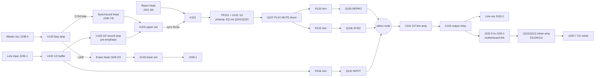

# Tascam 38 REC/PLAY AMPL card - circuit analysis

**Status:** Pass 3 (functional blocks) and Pass 4 (operating modes) complete
to the limit of the two sheets. Pass 5 (audit) not yet done. This is an
analysis of the existing card, not a replacement design, and nothing here is
a basis for powering a replacement card. No state, delay or level below has
been measured on a machine.

**Authority:** `sources/tascam-38-amplifier-schematic.pdf`, channel-1 card
drawing. Card contacts are as in `interface-matrix.csv` (38 VERIFIED, 12
UNRESOLVED). The per-block reports with drawing coordinates for every claim
are in `analysis/`:

| Block | Report |
| --- | --- |
| Reproduce, source selection, output, meter feed | `analysis/block-reproduce-output.md` |
| Sync pickup, K101/K103 head switching, K103 drive | `analysis/block-sync-headswitch.md` |
| Line input, record amplifier, bias, erase, meter amplifier | `analysis/block-record-bias-erase.md` |
| Relay coils, mutes, selection-gate drive, FUNCTION override | `analysis/block-control-muting.md` |
| OUT SELECT board: switch poles, K101 / K102 drivers and delays | `analysis/control-outselect.md` |
| FUNCTION board and the REC SIGNAL switch on MASTER OSC | `analysis/control-function.md` |
| Transport sheet: POWER MUTE, PLAY MUTE, REC MODE, REC SIGNAL | `analysis/control-transport.md` |

Each report separates what the drawing shows from interpretation. This
summary keeps that separation: statements marked *interpretation* are
reasoning from the traced topology, not printed facts.

## Devices

From the parts table on the sheet (around (1980-2900, 1150-1640)):

| Ref | Part | Type / role |
| --- | --- | --- |
| U101 | JRC-4558D-D | dual op-amp: reproduce/sync preamp (1/2), line amplifier (2/2) |
| U102 | RC-4558T1 | dual op-amp: input buffer (1/2), record amplifier (2/2) |
| U103 | listed only as "BIAS AMPL" | bias / erase amplifier; no part number or internals on this sheet |
| Q101, Q103, Q105, Q106, Q107, Q110 | 2SK68AM | N-channel JFET switches |
| Q108, Q111, Q118, Q120 | 2SC1684S | NPN |
| Q109, Q112 | 2SA733P | PNP |
| Q119 | 2SC1318S | NPN (bias enable) |
| D110, D111 | 1N60 | meter rectifier |
| K101, K102, K103 | - | relays; K102 drawn as a reed contact |

## Block diagram

## Functional blocks

### Reproduce and sync preamp (shared)

- The reproduce head reaches the card on J101-4 (one lead, to K101's fixed
  contact) and J101-3 (other lead, card common bus). The sync head on P151
  reaches it on J106-7 (to K103's upper moving contact) and J106-8 (common
  bus).
- **There is one preamp for both heads.** K101's moving contact feeds
  L101 1.2mH / C101 // C136 470p, then TR101, R101 10, R102 220k, into
  U101 1/2 pin 5. K101 selects between J101-4 (reproduce head) and a line
  from K103's upper fixed contact (sync path).
- U101 1/2 feedback: (R104 470k // C103 0.012) in series with (R106 33k //
  C104 270p // [R107 1.5k + switched branches]); shunt leg R103 330 + C102
  100u. The switched branches are R108 5k + Q101 (gated from J103-4, REPRO
  line) and R110 5k + Q103 (gated from J103-2, SYNC line) - separate EQ trims
  for reproduce and sync. *Interpretation:* reproduce equalisation set by
  the 470k // 0.012 network, with mode-specific mid/high correction.
- Output: R112 1k, L107/C137//C138 trap, C105 10u, Q107 PLAY MUTE shunt,
  then R120 10k (REPRO level, to Q105) and R122 10k (SYNC level, to Q106).

### Source selection and line output

- Q105 (REPRO), Q106 (SYNC) and Q110 (INPUT) are N-JFETs whose outputs join
  at (6543, 1109). INPUT comes from the U102 1/2 input buffer via C120 and
  the R156 20k trim.
- After selection: W109, W110, R113 1k / R114 10k, U101 2/2 (non-inverting,
  gain about 11 from R116 22k / R115 2.2k), R117 1k, C106 2.2u, R118 100k,
  L102 trap, then K102's contact to J102-2 (line output P131-1) and J102-5.
- J102-5 returns over the motherboard U-link to J105-1, so **the meter
  feed is taken after K102**: R119 56k, R141 50k meter trim, W112, C109,
  R142, into the Q111/Q112 meter amplifier, then C112 / R149, D110 clamp and
  D111 rectifier into C114, giving a positive DC level on J105-7 (VU meter
  P176-1).

### Record amplifier

- J106-1 (line input P141-1) through R160 27k (R161 22k to bus) into U102 1/2,
  a unity-gain follower. Its output (node A via C120) feeds the INPUT monitor
  tap (R202 / R156 / R157) and the record path.
- Record level: R165 12k to the R176 10k trim; wiper to U102 2/2.
- U102 2/2 feedback R179 39k + (R180 15k // C125 0.47u), shunt R178 4.7k,
  plus a series-resonant branch L103 2.4mH (adjustable) / R183 1k / C127
  0.0039 near 52 kHz with nominal values. *Interpretation:* record treble
  pre-emphasis.
- Output C126, R181 1.5k // C140 0.0027, test point TP1, then the
  L105 3mH // C131 390p trap (near 147 kHz nominal) to node N_REC, which is
  K103's upper lower-throw. *Interpretation:* the trap keeps bias out of the
  record amplifier.

### Bias and erase

- J108-4 (master oscillator P182-8, annotated AC10V) drives U103 pin 3.
  U103 runs from +B (pin 7) and -B (pin 1); its output node is annotated
  AC65V (pin 5), with L106 1.3mH (adjustable) across pins 5/6 and W132 to
  pin 4.
- **Bias injection:** AC65V node through the C134 100p trimmer onto the
  head-side lead J106-7 at (6620, 1930), not through K103. C134 sets bias.
- **Erase:** AC65V node through L108 (no value printed) to J108-2; return on
  J108-3 through K103's lower contact to J108-1 / U103 pin 6. No separate
  erase-current trim.
- **Bias enable:** U103 pin 2 through R198 8.2 to Q119 (emitter on -15V),
  driven by Q118 from J107-7 (FUNCTION) through D115 / R191 with a C132 10u
  delay (about 0.15 s). J107-7 high enables bias.

### Head switching (K103) and its drive

- K103 upper set: moving contact J106-7 (head). Throws: N_REC (record
  drive), which it is drawn resting on, and a line to K101's sync-side fixed
  contact.
- K103 lower set: moving contact J108-1. Throws: J108-3 (erase return),
  which it is drawn resting on, and the TP1 record-output node.
- Coil: J107-2 (24V) to Q120 collector, D114 across it; Q120 (NPN) emitter
  J107-1 (0V), base from J107-7 via D117 / R200 / R201 with R199 / C135.
  **K103 is energised when J107-7 is high.**

### Control inputs and muting

All polarities below come from traced diode orientation and device type, not
from signal names.

| Input (card contact, motherboard) | Element | Traced behaviour |
| --- | --- | --- |
| J101-2 (P180-2), J101-1 (0V) | K101 coil | energised when P180-2 is driven positive; OUT SELECT Q204 (PNP) sources it |
| J102-4 (P180-3), J102-3 (P171-3 POWER MUTE) | K102 coil | energised only when P180-3 is at 24V **and** POWER MUTE sinks current; open or high POWER MUTE keeps the output open |
| J104-1 (P171-6 PLAY MUTE) | Q107 shunt | passes when J104-1 is held negative (annotated -6.8V); at 0V or open Q107 conducts and mutes the SYNC/REPRO line. INPUT is not on this line |
| J103-6 (P181-3) | Q105 REPRO gate | Q105 on when P181-3 is at 24V; R125 to -15V holds it off otherwise |
| J104-5 (P181-2) | Q106 SYNC gate | Q106 on when P181-2 is at 24V and Q108 is off |
| J104-4 (P181-1), Q109 | Q110 INPUT gate | Q110 on when P181-1 is driven or Q109 conducts |
| J103-4 (P181-3), J103-2 (P181-2) | Q101 / Q103 EQ branches | each on when its line is at 24V |
| J104-3 (P174-1 FUNCTION) | Q108, then Q109 | Q108 on forces SYNC off (clamps via D108) and turns on Q109 (emitter fed from J104-2 / P180-4), forcing INPUT on. D109 / C119 hold Q108 on briefly after FUNCTION drops |
| J107-7 (P174-1 FUNCTION) | Q120 -> K103; Q118 / Q119 -> U103 | FUNCTION high energises K103 and enables bias |

*Interpretation:* J104-3 and J107-7 are the same motherboard net (P174-1),
so one FUNCTION line per channel switches the head to record drive, turns on
bias and erase, and forces the monitor to INPUT. That reads as the channel's
record-arm-and-record state; Pass 4 must confirm it against the FUNCTION and
transport circuitry.

From the OUT SELECT board (outside the card): the REPRO lower pole is a
changeover from 24V (J180-1) that at OFF feeds P180-4 (which supplies the
INPUT and SYNC poles and the Q109 emitter) and at ON feeds P181-3. Pressing
REPRO therefore also removes the INPUT/SYNC supply and the Q109 override.

## Relay drawn state

The sheet does not mark relay states, but the evidence on both sheets now
points one way. The OUT SELECT board drives K101 (P180-2) **only when SYNC is
pressed**, and draws SYNC pressed; K101 is drawn on the sync line. K103 is
energised by FUNCTION, and the printed Q120 voltages show it on; K103 is
drawn with the head on record drive and the erase loop closed.
*Interpretation:* the sheet draws K101 and K103 in their **energised**
positions, matching its printed operating state (SYNC pressed, channel in
record). So K101 released selects the reproduce head, and K103 released
connects the head to the sync line and puts J108-1 on TP1. This is
consistent across both sheets but still wants a bench continuity check (A1).

## Control sources

| Line | Driven by | Traced behaviour |
| --- | --- | --- |
| POWER MUTE (P171-3) | Q801 NPN on the POWER SUPPLY PCB, base RC-fed from the unregulated 6V rail | sinks current about 1.8 s after power-on in every mode; releases quickly at power-off. No transport logic reaches it |
| PLAY MUTE (P171-6) | Q534 NPN on the CONTROL PCB from U519 "PLAY OUT", divider R827 / R828 to -15V | -6.8V (passes) in PLAY, RECORD, punch and with CUE closed; +5.3V (mutes SYNC / REPRO) in STOP and FF / REW |
| REC SIGNAL (P171-5) | Q525 PNP on the CONTROL PCB from U519 "REC OUT" | 24V in RECORD and after punch-in; open in STOP, PLAY, FF / REW and after punch-out |
| REC MODE (P171-4) | FUNCTION PCB pole B | pulled to 0V while any channel switch is ON; open when all are OFF. The transport uses it only to gate the RECORD lamp |
| FUNCTION, ch n (J174-1..4, J175-1..4) | FUNCTION PCB pole C, fed from Q302 on the MASTER OSC PCB, switched by REC SIGNAL via Q301 | about 24V only when that channel's switch is ON **and** REC SIGNAL is high; otherwise open, never driven low |
| P180 / P181 | OUT SELECT PCB switches | see the table below |

OUT SELECT, steady state (P180-1 is 24V in, P180-5 is 0V; "open" means
undriven):

| Pressed | P180-2 (K101) | P180-3 (K102) | P180-4 | P181-1 INPUT | P181-2 SYNC | P181-3 REPRO |
| --- | --- | --- | --- | --- | --- | --- |
| INPUT | open | 24V | 24V | 24V | open | open |
| SYNC | 24V | 24V | 24V | open | 24V | open |
| REPRO | open | 24V | open | open | open | 24V |
| none | open | open | 24V | open | open | open |

P180-3 rises about 0.5 s after any press and drops almost at once on
release, so every change of selection opens K102 briefly; K101 switches
inside that mute. These delays are computed from part values, not printed.

## Operating modes

Per channel. "Armed" means that channel's FUNCTION switch is ON. Monitor =
what reaches the line output J102-2 and, through J102-5 / J105-1, the meter.

| Transport | Armed | Selected | K101 | K103, bias, erase | Source on | PLAY MUTE | K102 | Monitor |
| --- | --- | --- | --- | --- | --- | --- | --- | --- |
| Power-up, first ~1.8 s | any | any | - | released, off | - | - | open | silent |
| STOP, FF / REW | any | INPUT | released | released, off | Q110 | mutes | closed | line input |
| STOP, FF / REW | any | SYNC | energised | released, off | Q106 | mutes | closed | silent |
| STOP, FF / REW | any | REPRO | released | released, off | Q105 | mutes | closed | silent |
| FF / REW, CUE closed | any | SYNC / REPRO | as above | released, off | Q106 / Q105 | passes | closed | sync / repro head (cue) |
| PLAY | any | INPUT | released | released, off | Q110 | passes | closed | line input |
| PLAY | any | SYNC | energised | released, off | Q106 | passes | closed | sync head off tape |
| PLAY | any | REPRO | released | released, off | Q105 | passes | closed | repro head off tape |
| any | any | none | released | per transport | none | - | open | silent |
| RECORD | no | any | as PLAY | released, off | as PLAY | passes (M2) | as PLAY | as PLAY |
| RECORD | yes | INPUT | released | energised, on | Q110 | passes (M2) | closed | line input |
| RECORD | yes | SYNC | energised | energised, on | Q110 (Q108 forces SYNC off, Q109 forces INPUT on) | passes (M2) | closed | line input |
| RECORD | yes | REPRO | released | energised, on | Q105 (no override: REPRO removes P180-4, Q109's supply) | passes (M2) | closed | repro head off tape |

Transitions:

- **Punch in** (REC SIGNAL rises): armed channels go to their RECORD row.
  K103 pulls in; U103 bias comes on after the C132 delay (about 0.15 s); an
  armed channel monitoring SYNC switches to INPUT. PLAY MUTE is unaffected.
- **Punch out** (REC SIGNAL drops): FUNCTION goes open, K103 releases and
  bias turns off; D109 / C119 hold Q108 on briefly, so the INPUT override
  outlasts the record state before SYNC returns.
- **K103 released** puts the record-amplifier output TP1 onto J108-1, which
  is 0V if C17 holds - the record drive is grounded when not recording.
- Recording does not need a selection button: with none pressed K102 stays
  open and the monitor is silent, but an armed channel still records.

*Interpretation:* SYNC monitoring is overdubbing from the record head;
selecting SYNC on an armed track while recording falls back to INPUT
because the head cannot pick up while it records. REPRO bypasses that
fallback, giving off-tape monitoring through the separate reproduce head.

## Open items

| ID | Item | Location / evidence | What resolves it |
| --- | --- | --- | --- |
| A1 | Which relay position is energised for K101 and K103. Both sheets now point to "drawn energised" (see Relay drawn state); not yet confirmed on hardware | block-sync-headswitch.md U1; control-outselect.md | Continuity check across each relay with its coil driven and undriven |
| A2 | *Resolved by Pass 4:* POWER MUTE is Q801 on the power supply PCB; PLAY MUTE is Q534 on the control PCB, and -6.8V is its PLAY level | control-transport.md | - |
| A3 | Q118 base annotated -14.4V (bias off) while J107-7 is annotated 24V (bias on) | block-record-bias-erase.md | Probably measured in different modes; confirm by measurement |
| A4 | U103 internals and part number not on this sheet | parts table lists "BIAS AMPL" only | Service manual or physical part |
| A5 | L108 value not printed; bias frequency not on this sheet | block-record-bias-erase.md | Service manual; master oscillator sheet |
| A6 | Whether -5.2V / -6.2V gate bias fully pinches off a 2SK68AM (M grade) | block-control-muting.md | 2SK68A datasheet pinch-off range |
| A7 | R139 printed "68" (ohms, or a missing k) | block-control-muting.md | Physical part or parts list |
| A8 | W119 drawn faint and broken (fitted or not); W109 / W110 / W112 fitted | block-record-bias-erase.md, block-reproduce-output.md | Physical card |
| A9 | U101 / U102 input polarity (no +/- marks drawn) | block-reproduce-output.md | 4558 pinout |
| A10 | J108-1 to 0V (matrix C17) decides whether the released K103 grounds the record output | interface-matrix.csv | Continuity P108-1 to P171-7 |
| A11 | OUT SELECT upper-pole network that decides when the K101 / K102 drivers turn on | block-control-muting.md | Trace the OUT SELECT board fully (Pass 4) |
