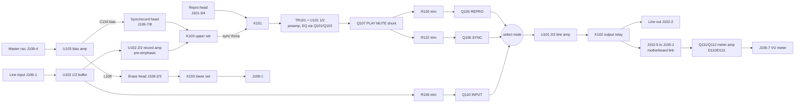

# Tascam 38 REC/PLAY AMPL card - circuit analysis

**Status:** Passes 0-5 of `docs/superpowers/plans/2026-10-13-tascam-38-electrical-analysis.md`
complete, followed by a further round (Pass 6) that traced the remaining
drawing-traceable unknowns, read the component datasheets and the Tascam 38
Operation and Maintenance manual, and recorded the first bench results. The
analysis is complete with open evidence questions: the items under Open
items, most of which now need the physical machine. This is an
analysis of the existing card, not a replacement design, and nothing here is
a basis for building or powering a replacement card. No state, delay or level
below has been measured on a machine.

**Authority:** `sources/tascam-38-amplifier-schematic.pdf` (channel-1 card,
motherboard, OUT SELECT, FUNCTION, MASTER OSC) and
`sources/tascam-38-transport-schematic.pdf` (power supply and control).
Card contacts are as in `interface-matrix.csv`. The reports behind each
section, with drawing coordinates for every claim, are:

| Topic | Report |
| --- | --- |
| Reproduce, source selection, output, meter feed | `analysis/block-reproduce-output.md` |
| Sync pickup, K101/K103 head switching, K103 drive | `analysis/block-sync-headswitch.md` |
| Line input, record amplifier, bias, erase, meter amplifier | `analysis/block-record-bias-erase.md` |
| Relay coils, mutes, selection-gate drive, FUNCTION override | `analysis/block-control-muting.md` |
| OUT SELECT board: switch poles, K101 / K102 drivers and delays | `analysis/control-outselect.md` |
| FUNCTION board and the REC SIGNAL switch on MASTER OSC | `analysis/control-function.md` |
| Transport sheet: POWER MUTE, PLAY MUTE, REC MODE, REC SIGNAL | `analysis/control-transport.md` |
| Per-contact traces and the independent re-traces | `trace/` |
| Pass 5 independent audits of this document and of the earlier notes | `analysis/pass5-audit-analysis.md`, `analysis/pass5-audit-notes.md` |
| Pass 6: PAUSE, auto-stop guard, punch logic, PLAY OUT loads | `analysis/pass6-transport-pause-autostop.md` |
| Pass 6: record entry, REC MODE, RECORD lamp, the "+2V" tap | `analysis/pass6-transport-record-entry.md` |
| Pass 6: master oscillator, channel-2 FUNCTION, sheet notes, relay timing | `analysis/pass6-amp-osc-notes-timing.md` |
| Pass 6: datasheets and the Tascam 38 manual (external, cited with URLs) | `analysis/pass6-datasheets.md` |

Each report separates what the drawing shows from interpretation, and so
does this summary: statements marked *interpretation* are reasoning from the
traced topology, not printed facts.

## Summary

| Measure | Count |
| --- | --- |
| Card contacts (J101-J108) | 50 |
| VERIFIED - card node and motherboard endpoint agreed by two independent traces | 38 |
| UNRESOLVED - no wire drawn on at least one side (11), one disputed junction (1) | 12 |
| CANDIDATE / CONTRADICTED | 0 / 0 |
| Drawing claims spot-checked by the Pass 5 auditor | 25 (24 confirmed, 1 undecidable: M4) |
| Bench measurements recorded | 2 (both as predicted; K101 and K103 upper set) |

The card is a full record/reproduce module. One preamp serves both heads;
three JFETs select the monitored source; one FUNCTION line per channel
switches the head to record, enables bias and erase, and overrides the
monitor to INPUT unless REPRO is selected; the output relay K102 doubles as
a power-up and source-change mute. What remains open is listed under Open
items, and the checks that would settle it under Bench verification
checklist.

## Boards and connectors

| Board | What crosses the motherboard boundary |
| --- | --- |
| HEAD PCB | Reproduce, sync and erase head windings and shield returns |
| REC/PLAY AMPL PCB (x8) | Everything on J101-J108; one design for all eight channels |
| IN/OUT PCB | Eight line inputs (P141...) and outputs (P131...) |
| FUNCTION PCB | Per-channel record-ready switches; FUNCTION lines on J174 / J175, buses on J173 |
| OUT SELECT PCB | INPUT / SYNC / REPRO selection on J180 / J181; K101 / K102 drivers |
| MASTER OSC PCB | Bias oscillator to every card on J182; the REC SIGNAL switch Q301 / Q302 |
| MOTHER PCB | Routing and power / control distribution |

Head connectors: channel 1 REPRO P401/J401 to J121/P121, SYNC P402/J402 to
J151/P151, ERASE P403/J403 to J161/P161; channels 2-8 on J122-J128,
J152-J158, J162-J168. The HEAD PCB draws a vertical conductor joining the
shield / return symbols at J401, J402 and J403 - a common head-board shield
network separate from the winding conductors. P121, P151 and P161 have no
printed pin numbers (C20). P172/J172 is a two-contact connector beside
P171/J171 whose identity was not traced. The sheet's note says the schematic
shows one channel except for some components (C10).

P171/J171, the bus between the two sheets (printed names):

| Pin | Signal | Pin | Signal |
| --- | --- | --- | --- |
| 1 | 6V | 7 | 0V |
| 2 | 0V | 8 | 24V |
| 3 | POWER MUTE | 9 | +B(15V) |
| 4 | REC MODE | 10 | -B(-15V) |
| 5 | REC SIGNAL | 11 | 0V |
| 6 | PLAY MUTE | | |

On the card, +B arrives on J105-5, J106-4, J107-3; -B on J103-5, J105-6,
J106-3, J107-4; 24V on J107-2; 0V on J101-1, J104-6, J107-1 and, through the
common bus, J106-5 / -6.

## Devices

From the parts table on the amplifier sheet (around (1980-2900, 1150-1640)):

| Ref | Part | Type / role |
| --- | --- | --- |
| U101 | JRC-4558D-D | dual op-amp: reproduce/sync preamp (1/2), line amplifier (2/2) |
| U102 | RC-4558T1 | dual op-amp: input buffer (1/2), record amplifier (2/2) |
| U103 | listed only as "BIAS AMPL"; the 38 manual's parts list gives "BIAS Ampl. Module", TEAC 5292210600 | bias / erase amplifier module; internals unpublished |
| Q101, Q103, Q105, Q106, Q107, Q110 | 2SK68AM | N-channel JFET switches |
| Q108, Q111, Q118, Q120 | 2SC1684S | NPN |
| Q109, Q112 | 2SA733P | PNP |
| Q119 | 2SC1318S | NPN |
| D110, D111 | 1N60 | meter rectifier |
| K101, K102, K103 | - | relays; K102 drawn as a reed contact |

OUT SELECT: Q201 / Q203 2SC1684S, Q202 / Q204 2SA720Q, D201-D207 1S2473HJ.
MASTER OSC: U301 "OSC UNIT", a sealed four-pin module (nothing drawn inside;
+B on pin 3, -B on pins 1 and 6, output pin 4 to J182-8), Q301 2SC1684S,
Q302 2SA564R. Transport: U519 is printed "H54410P" on the sheet; the 38
manual's parts list gives M54410P (Mitsubishi "Key Controller for Tape
Deck"), and its datasheet matches the traced pins.

Datasheet facts the analysis relies on (sources in `analysis/pass6-datasheets.md`):
2SK68A (NEC) M grade IDSS 2.0-6.0 mA, VGS(off) -1.5 V worst case, so the
-5.2 / -6.2 V off-state gate bias holds the selection JFETs off with margin
(but see A12); 4558 pinout 1 OUT A, 2 -IN A, 3 +IN A, 4 V-, 5 +IN B,
6 -IN B, 7 OUT B, 8 V+, consistent with every traced pin; 2SC1318 VCEO 50 V,
IC 500 mA; 2SA720 VCEO -50 V, IC -500 mA.

## Block diagram

## Functional blocks

### Reproduce and sync preamp (shared)

- The reproduce head reaches the card on J101-4 (one lead, to K101's fixed
  contact) and J101-3 (other lead, card common bus). The sync head on P151
  reaches it on J106-7 (to K103's upper moving contact) and J106-8 (common
  bus).
- **There is one preamp for both heads.** K101's moving contact feeds
  TR101 pin 1, with an L101 1.2mH + (C101 // C136 470p) trap from that node
  to the bus; then R101 10, R102 220k, into U101 1/2 pin 5. K101 selects
  between J101-4 (reproduce head) and a line from K103's upper fixed contact
  (sync path).
- U101 1/2 feedback: (R104 470k // C103 0.012) in series with (R106 33k //
  C104 270p // [R107 1.5k + switched branches]); shunt leg R103 330 + C102
  100u. The switched branches are R108 5k + Q101 (gated from J103-4, REPRO
  line) and R110 5k + Q103 (gated from J103-2, SYNC line) - separate EQ trims
  for reproduce and sync. *Interpretation:* reproduce equalisation set by
  the 470k // 0.012 network, with mode-specific correction.
- Output: R112 1k, L107/C137//C138 trap, C105 10u, Q107 PLAY MUTE shunt,
  then R120 10k (REPRO level, to Q105) and R122 10k (SYNC level, to Q106).

### Source selection and line output

- Q105 (REPRO), Q106 (SYNC) and Q110 (INPUT) are series N-JFET switches whose
  outputs join at (6543, 1109). INPUT comes from the U102 1/2 input buffer
  via C120 and the R156 20k trim.
- After selection: W109, W110, R113 1k / R114 10k, U101 2/2 (non-inverting,
  gain about 11 from R116 22k / R115 2.2k), R117 1k, C106 2.2u, R118 100k,
  L102 trap, then K102's contact to J102-2 (line output P131-1) and J102-5.
- J102-5 returns over the motherboard U-link to J105-1, so **the meter
  feed is taken after K102**: R119 56k, R141 50k meter trim, W112, C109,
  R142, into the Q111/Q112 meter amplifier, then C112 / R149, D110 clamp and
  D111 rectifier into C114, giving a positive DC level on J105-7 (VU meter
  P176-1).

### Record amplifier

- J106-1 (line input P141-1) through R160 27k (R161 22k to bus) into U102 1/2,
  a unity-gain follower. Its output (node A via C120) feeds the INPUT monitor
  tap (R202 / R156 / R157) and the record path.
- Record level: R165 12k to the R176 10k trim; wiper to U102 2/2.
- U102 2/2 feedback R179 39k + (R180 15k // C125 0.47u), shunt R178 4.7k,
  plus a series-resonant branch L103 2.4mH (adjustable) / R183 1k / C127
  0.0039 near 52 kHz with nominal values. *Interpretation:* record treble
  pre-emphasis.
- Output C126, R181 1.5k // C140 0.0027, test point TP1, then the
  L105 3mH // C131 390p trap (near 147 kHz nominal) to node N_REC, which is
  one throw of K103's upper set. *Interpretation:* the trap keeps bias out of
  the record amplifier.

### Bias and erase

- J108-4 (master oscillator P182-8, annotated AC10V) drives U103 pin 3.
  U103 runs from +B (pin 7) and -B (pin 1); its output node is annotated
  AC65V (pin 5), with L106 1.3mH (adjustable) across pins 5/6 and W132
  (drawn linked) joining pin 5 to pin 4.
- **Bias injection:** from U103 pin 4 - which W132 joins to the AC65V node -
  through the C134 100p trimmer onto the head-side lead J106-7 at
  (6620, 1930), not through K103. *Interpretation:* C134 is the bias-level
  adjustment.
- **Erase:** AC65V node through L108 (no value printed) to J108-2; return on
  J108-3 through K103's lower contact to J108-1 / U103 pin 6. No separate
  erase-current trim is drawn.
- **Bias control:** U103 pin 2 goes through R198 8.2 to Q119 (NPN, emitter on
  -15V), driven by Q118 (NPN) from J107-7 (FUNCTION) through D115 / R191,
  with C132 10u in the base chain (time constant about 0.15 s).
  *Interpretation:* J107-7 high returns U103 pin 2 to -B through Q119, read
  as enabling the bias amplifier; U103's internals are not on the sheet (A4).
  The 38 manual (section 1-16-2) confirms this role: U103 amplifies the U301
  master-oscillator signal when Q119 turns on. Its Fig. 1-16(B) gives bias
  starting 80 ms after REC ON and taking 90 ms to rise, and starting 40 ms
  after REC OFF and taking 70 ms to fall.
- **Bias frequency:** 150 kHz, from the manual's specifications (the
  oscillator module U301 runs whenever the machine is powered; REC SIGNAL
  does not gate it). It agrees with the card's L105 / C131 trap near
  147 kHz.

### Head switching (K103) and its drive

- K103 upper set: moving contact J106-7 (head). Throws: N_REC (record
  drive), which it is drawn resting on, and a line to K101's sync-side fixed
  contact.
- K103 lower set: moving contact J108-1. Throws: J108-3 (erase return),
  which it is drawn resting on, and the TP1 record-output node.
- Coil: J107-2 (24V) to Q120 collector, D114 across it; Q120 (NPN) emitter
  J107-1 (0V), base from J107-7 via D117 / R200 39k / R201 1.5k with R199 22k
  and C135 33u slowing it. **K103 is energised when J107-7 is high.**
  Computed from part values: pull-in about 40-70 ms after J107-7 rises,
  release about 0.1-0.2 s after it drops (assumes Q120 hFE 100-400 and a
  1-2k coil, neither printed; M6).

### Control inputs and muting

All polarities below come from traced diode orientation and device type, not
from signal names.

| Input (card contact, motherboard) | Element | Traced behaviour |
| --- | --- | --- |
| J101-2 (P180-2), J101-1 (0V) | K101 coil | energised when P180-2 is driven positive; OUT SELECT Q204 (PNP) sources it |
| J102-4 (P180-3), J102-3 (P171-3 POWER MUTE) | K102 coil | energised only when P180-3 is at 24V **and** POWER MUTE sinks current; open or high POWER MUTE keeps the output open |
| J104-1 (P171-6 PLAY MUTE) | Q107 shunt | passes when J104-1 is held negative (annotated -6.8V); at 0V or open Q107 conducts and mutes the SYNC/REPRO line. INPUT is not on this line |
| J103-6 (P181-3) | Q105 REPRO gate | Q105 on when P181-3 is at 24V; R125 to -15V holds it off otherwise |
| J104-5 (P181-2) | Q106 SYNC gate | Q106 on when P181-2 is at 24V and Q108 is off |
| J104-4 (P181-1), Q109 | Q110 INPUT gate | Q110 on when P181-1 is driven or Q109 conducts |
| J103-4 (P181-3), J103-2 (P181-2) | Q101 / Q103 EQ branches | each on when its line is at 24V |
| J104-3 (P174-1 FUNCTION) | Q108, then Q109 | Q108 on forces SYNC off (clamps via D108) and turns on Q109 (emitter fed from J104-2 / P180-4), forcing INPUT on while P180-4 is live. D109 / C119 hold Q108 on after FUNCTION drops |
| J107-7 (P174-1 FUNCTION) | Q120 -> K103; Q118 / Q119 -> U103 pin 2 | FUNCTION high energises K103 and (interpretation) enables bias |

J104-3 and J107-7 are the same motherboard net (P174-1). So one FUNCTION
line per channel switches the head to record drive, enables bias and erase,
and, unless REPRO is selected, forces the monitor to INPUT. FUNCTION is high
only when that channel's switch is ON and REC SIGNAL is high (Control
sources).

## Relay drawn state

The sheet does not mark relay states. *Interpretation:* K101 and K103 are
drawn in their **energised** positions. The support is functional coherence:
the OUT SELECT board drives K101 (P180-2) only when SYNC is pressed, so
"K101 energised = sync line" routes the sync head into the SYNC path; and
FUNCTION, which enables bias, energises K103, so "K103 energised = head on
record drive, erase loop closed" keeps bias off a head connected to the
pickup line. The opposite reading would route the reproduce head into the
SYNC path and put bias on the sync pickup.

Against reading the sheet as one printed snapshot: K102 is drawn open
although the same annotations put 24V on its coil and POWER MUTE sinks in
every settled state, so the sheet does not use one convention for all three
relays, and the A3 conflict suggests the annotations were not all taken in
one state. On the reading above, K101 released selects the reproduce head,
and K103 released connects the head to the sync line and puts J108-1 on TP1.
It wants a bench continuity check (A1).

**Bench evidence (owner, 2026-10-13, ohmmeter on a card, coils unpowered):**
J101-4 to J101-3 read 0 ohms and J106-7 to TP1 read open. Released, K101
therefore connects the reproduce head (J101-4) through the TR101 primary to
the common bus, and K103's upper set does not put the head on the record
drive - both as the "drawn energised" reading predicts, and opposite to what
"drawn released" would give. K103's lower set (J108-1 to J108-3 open,
J108-1 to TP1 near 0 ohms, predicted) has not yet been measured. The 0 ohm
reading also implies a very low TR101 primary DC resistance.

## Control sources

| Line | Driven by | Traced behaviour |
| --- | --- | --- |
| POWER MUTE (P171-3) | Q801 NPN on the POWER SUPPLY PCB, base RC-fed from the unregulated 6V rail | sinks current about 1.8 s after power-on if the rail is 6V (M6), in every mode; releases within about 0.5-1 s of power-off (computed). No transport logic reaches it |
| PLAY MUTE (P171-6) | Q534 NPN on the CONTROL PCB from U519 "PLAY OUT"; level-shifted by R827 / R828 to -15V on the POWER SUPPLY PCB | -6.8V (passes) in PLAY, RECORD and punch; about -6.6V with CUE closed; +5.3V (mutes SYNC / REPRO) in STOP, FF / REW, PAUSE, record-pause, and while the auto-stop guard is asserted |
| REC SIGNAL (P171-5) | Q525 PNP on the CONTROL PCB from U519 "REC OUT" | 24V in RECORD, record-pause and after punch-in; open in STOP, PLAY, PAUSE, FF / REW, after punch-out, and while the auto-stop guard is asserted |
| REC MODE (P171-4) | FUNCTION PCB pole B | pulled to 0V while any channel switch is ON; open when all are OFF. On the transport it reaches only the RECORD-lamp gate: lamp steady when recording with a channel armed, flashing about 1 Hz when recording with none. It does not gate record entry |
| FUNCTION, ch n (J174-1..4, J175-1..4) | FUNCTION PCB pole C, fed from Q302 on the MASTER OSC PCB, switched by REC SIGNAL via Q301 | about 24V only when that channel's switch is ON **and** REC SIGNAL is high; otherwise open, never driven low |
| P180 / P181 | OUT SELECT PCB switches | see the table below |

The PLAY OUT / REC OUT polarities above come from the M54410P datasheet
(outputs active high; PLAY OUT high in PLAY and REC/PLAY; REC OUT high in
REC/PLAY and REC/PAUSE; PAUSE OUT high in PAUSE, with PLAY OUT low). The
traced loads agree: the capstan solenoid is driven from PLAY OUT alone.

### Transport logic that reaches the card

- **Record entry:** the RECORD key (S605) and the remote's RECORD line pull
  U519 pin 7 (REC IN) low; per the datasheet, REC takes effect only together
  with PLAY. REC MODE plays no part, so the transport enters record with no
  channel armed (nothing is recorded; the RECORD lamp flashes).
- **Punch in:** the footswitch, through U505 and Q505, pulls the PLAY and
  RECORD key lines low together - the same as pressing both. **Punch out:**
  Q506 pulses U519 pin 9 (AR, record inhibit), dropping REC OUT. PLAY OUT is
  not touched, so PLAY MUTE stays at -6.8V through a punch. STOP, FF and REW
  clear the punch latch; every rise of REC OUT presets it, so the footswitch
  can also punch out of a record started from the panel.
- **Auto-stop / start-up guard:** comparator U516A, timed by R569 / C524,
  pulls PLAY OUT and REC OUT low through Q522 / Q523. It is asserted for
  about 1 s at power-up, throughout FF / REW, and while the reels coast
  after FF / REW plus about 1 s (including when PLAY or RECORD is pressed
  during the coast). It is not asserted in STOP at rest, PLAY, RECORD or
  PAUSE. When the tape sensor PH501 sees no tape, Q518 holds the STOP key
  line low instead. Durations are computed and assume a single 5V logic rail.

| Pressed | P180-2 (K101) | P180-3 (K102) | P180-4 | P181-1 INPUT | P181-2 SYNC | P181-3 REPRO |
| --- | --- | --- | --- | --- | --- | --- |
| INPUT | open | 24V | 24V | 24V | open | open |
| SYNC | 24V | 24V | 24V | open | 24V | open |
| REPRO | open | 24V | open | open | open | 24V |
| none | open | open | 24V | open | open | open |

P180-3 rises about 0.5 s after a press and drops almost at once on release,
so - assuming one button at a time (M5) - every change of selection opens
K102 briefly, and K101 switches inside that mute. These delays are computed
from part values, not printed.

## Operating modes

Per channel. "Armed" means that channel's FUNCTION switch is ON. Monitor =
what reaches the line output J102-2 and, through J102-5 / J105-1, the meter.
The table assumes latching OUT SELECT switches with one pressed at a time
(M5). Head identities in the Monitor column follow A1 (bench-confirmed for
K101 and K103's upper set).

| Transport | Armed | Selected | K101 | K103, bias, erase | Source on | PLAY MUTE | K102 | Monitor |
| --- | --- | --- | --- | --- | --- | --- | --- | --- |
| Power-up, first ~1.8 s | any | any | - | released, off | - | - | open | silent |
| STOP, FF / REW | any | INPUT | released | released, off | Q110 | mutes | closed | line input |
| STOP, FF / REW | any | SYNC | energised | released, off | Q106 | mutes | closed | silent |
| STOP, FF / REW | any | REPRO | released | released, off | Q105 | mutes | closed | silent |
| FF / REW, CUE closed | any | SYNC / REPRO | as above | released, off | Q106 / Q105 | passes | closed | sync / repro head (cue) |
| PLAY | any | INPUT | released | released, off | Q110 | passes | closed | line input |
| PLAY | any | SYNC | energised | released, off | Q106 | passes | closed | sync head off tape |
| PLAY | any | REPRO | released | released, off | Q105 | passes | closed | repro head off tape |
| any except RECORD with armed | any | none | released | per transport | none | - | open | silent |
| RECORD | yes | none | released | energised, on | Q110 (Q109 override; P180-4 is live) | passes | open | silent |
| RECORD | no | any | as PLAY | released, off | as PLAY | passes | as PLAY | as PLAY |
| RECORD | yes | INPUT | released | energised, on | Q110 | passes | closed | line input |
| RECORD | yes | SYNC | energised | energised, on | Q110 (Q108 forces SYNC off, Q109 forces INPUT on) | passes | closed | line input |
| RECORD | yes | REPRO | released | energised, on | Q105 (no override: REPRO removes P180-4, Q109's supply) | passes | closed | repro head off tape |
| PAUSE (from PLAY) | any | any | per selection | released, off | per selection | mutes | closed if selected | line input if INPUT, else silent |
| Record-pause | no | any | per selection | released, off | per selection | mutes | closed if selected | line input if INPUT, else silent |
| Record-pause | yes | INPUT / SYNC / none | per selection | energised, on (tape stopped) | Q110 (override) | mutes | closed if a button is pressed | line input with INPUT or SYNC; silent with none |
| Record-pause | yes | REPRO | released | energised, on (tape stopped) | Q105 | mutes | closed | silent |
| Auto-stop guard asserted (power-up, FF / REW, coast) | any | any | per selection | released, off | per selection | mutes (passes with CUE) | per selection and POWER MUTE | line input if INPUT, else silent |

If two buttons are held together (no interlock is drawn, M5), the traced
topology gives: **REPRO + SYNC** - K101 energised and P180-4 open, so Q106
and Q103 are off and Q105 and Q101 on: the sync head through the REPRO trim
and EQ (silent apart from bias pickup on an armed channel in RECORD, where
K103 opens the sync line); **INPUT + SYNC** - Q110 and Q106 both on, the two
sources summed at the select node, K101 energised; **INPUT + REPRO** - P180-4
open, so INPUT is off even on an armed channel in RECORD; the reproduce head
via Q105. Pressing a second button without releasing the first does not drop
K102.

Transitions:

- **Punch in** (REC SIGNAL rises): armed channels go to their RECORD row.
  K103 pulls in after about 40-70 ms (computed); bias starts 80 ms after
  REC ON and rises over 90 ms (manual Fig. 1-16(B)); an armed channel
  monitoring SYNC switches to INPUT. PLAY MUTE is unaffected.
- **Punch out** (REC SIGNAL drops): FUNCTION goes open; bias starts falling
  40 ms later over 70 ms (manual); K103 releases after about 0.1-0.2 s
  (computed); D109 / C119 hold Q108 on for about 0.4-0.5 s (R139 is 68 ohm,
  A7), so the INPUT override outlasts K103 before SYNC returns.
- **Record-pause** keeps REC OUT, so an armed channel holds K103, bias and
  erase on while the tape is stopped.
- **K103 released** puts the record-amplifier output TP1 onto J108-1, which
  is 0V if C17 holds - the record drive is grounded when not recording.
- Recording does not need a selection button: with none pressed K102 stays
  open and the monitor is silent, but an armed channel still records.

*Interpretation:* SYNC monitoring is overdubbing from the record head;
selecting SYNC on an armed track while recording falls back to INPUT
because the head cannot pick up while it records. REPRO bypasses that
fallback, giving off-tape monitoring through the separate reproduce head.

## Uncertainty register (matrix `uncertainty_id`)

| ID | Issue | Status |
| --- | --- | --- |
| C01 | J106 7 vs 8 contacts | Resolved: 8, giving 50 contacts |
| C02 | J102-5 to J105-2 vs J105-1 to J102-5 (worksheet) | Resolved: card J102-5 joins J102-2; J105-2 has no wire; P102-5 joins P105-1 on the motherboard |
| C03 | J103-4 possibly erase head / J108-3 | Resolved: J103-4 is OUT SELECT P181-3; erase is J108-2/3 via P161 |
| C04 | J103-6 links to J103-4 | Resolved: joined on the motherboard at P181-3, not on the card |
| C05 | J103-5 target written as `107` | Resolved: J103-5 is -B on P171-10 |
| C06 | J101-2 K101 relay behaviour | Resolved: J101-2 / J101-1 are the coil (P180-2 / 0V); contacts are J101-4 and the sync line |
| C07 | J106-8 marked GND | Resolved: J106-8 is the second sync-head lead (P151), tied to the card common bus |
| C08 | J107-6 unknown; J107-7 to J174-1 | J107-7 resolved (P174-1). J107-6: no wire on either side - physical check |
| C09 | Worksheet X cells | No wire on either side (J102-7, J103-1/3, J104-7, J105-2/3/4, J107-5) or on the motherboard side (J102-1/6) - physical check |
| C10 | Channel-1 drawing vs channels 2-8 | *Resolved for the cards (owner, 2026-10-14):* all cards are the same; the owner has 16 spare cards from two non-working units. The sheet's note says some components differ between channels and does not list them. My reading, not verified, is that the note means the per-channel motherboard parts (J17x pins, channel bus lines), which are drawn for every channel. Remaining: any per-channel difference on the motherboard |
| C11 | Three 0V supply contacts | Resolved as to connection (J106-5/6 to P171-11, others to P171-7); current-return distribution not analysed |
| C12 | Head shield / winding conductor interpretation | Open: winding polarity and shield termination need the physical HEAD PCB |
| C13 | P104-7 joined to P107-2 | Resolved: refuted; P104-7 has no wire |
| C14 | No card contact reaches the Q105/Q106/Q110 gates | Resolved: gates fed via bias nodes from P181-1/2/3 and Q109 (see Control inputs) |
| C15 | Italic voltage annotations are not rail names | Resolved: every rail identified by its P171 route |
| C16 | "24V" annotation leader ambiguous between J104-3 and J104-5 | Resolved: J104-3 is P174-1 (FUNCTION); the leader points at the D109 vertical |
| C17 | Crossings at (4141, 3730) / (4242, 3730) decide whether P108-1 is on 0V | Open: tracers split two (dot) to two (may be a dot), none read a plain crossing - continuity P108-1 to P171-7 |
| C18 | Thickening where P104-5 crosses the P171-11 0V vertical at (4145, 3033) | Caveat on a VERIFIED row: read as no dot - continuity check |
| C19 | Ink blob at (4195, 3472) where the +B riser crosses the 2ch P102-2 line | Caveat on VERIFIED rows: read as no dot by every tracer - continuity check |
| C20 | P121 / P151 / P161 have no printed pin numbers | Open: contacts cited as upper / lower; physical inspection |

## Open items

| ID | Item | Location / evidence | What resolves it |
| --- | --- | --- | --- |
| A1 | Which relay position is energised for K101 and K103. K101 and K103's upper set confirmed by bench continuity: drawn energised (Relay drawn state). K103's lower set not yet measured | block-sync-headswitch.md U1; control-outselect.md; bench 2026-10-13 | J108-1 to J108-3 and J108-1 to TP1, coil unpowered |
| A2 | *Resolved by Pass 4:* POWER MUTE is Q801; PLAY MUTE is Q534, and -6.8V is its PLAY level | control-transport.md | - |
| A3 | Q118 base annotated -14.4V (bias off) while J107-7 is annotated 24V (bias on) | block-record-bias-erase.md; Pass 5 audit | Either the annotations come from different modes or a value is misplaced (-14.4V is what Q119's base reads when on); not decidable from the sheet - measure in RECORD |
| A4 | U103 is a TEAC "BIAS Ampl. Module" (5292210600, per the manual's parts list); its internals are unpublished. The can is stamped "TEAC / 52922 / -016" (the character before "-016" is unclear in the photo), so "52922" matches the start of the manual's number. The can has an adjustment hole | pass6-datasheets.md; owner photo 2026-10-14, `bench/photos/2026-10-14-u103-k103-area.jpg` | Physical module, if its behaviour matters for a replacement |
| A5 | L108 value not printed. *Bias frequency resolved:* 150 kHz (manual specifications) | block-record-bias-erase.md; pass6-datasheets.md | Physical part for L108 |
| A6 | *Resolved by datasheet:* 2SK68A VGS(off) is -1.5 V worst case, so -5.2 / -6.2 V holds the JFETs off with margin while the signal stays near 0V (see A12) | pass6-datasheets.md | - |
| A7 | *Resolved by inspection:* R139 is 68 ohm. Its bands, read from the end opposite the gold tolerance band, are blue, grey, black: 68 x 1. The grey band shows weakly against the tan body, but blue-black is not a standard value. The same reading direction gives the drawn values for its neighbours: R138 blue-grey-orange 68k, R137 yellow-violet-orange 47k, R136 red-violet-orange 27k | owner photo 2026-10-14, `bench/photos/2026-10-14-r139-q108-area.jpg` (a spare card; all cards are the same, C10) | - |
| A8 | W119 drawn faint and broken; W109 / W110 / W112 / W132 drawn linked - whether fitted is a physical-board question. *Partly resolved (owner photos, 2026-10-14, one spare card):* W119 is fitted, so the faint drawing does not mean it is absent. The owner could not find W132 on the component side; its silkscreen label is not visible near U103. The drawing puts W132 directly between U103 pins 4 and 5, so it may sit under the U103 can, be a track, or be absent. Also seen fitted: W108, W111, W123, W124, W127-W131, W133-W135. Seen empty: W116, W117, W120, W121, W122, and the C128-C130 / R184-R186 positions | block-record-bias-erase.md, block-reproduce-output.md; `bench/photos/2026-10-14-*.jpg` | W132: ohmmeter across U103 pins 4 and 5. W109 / W110 / W112: look |
| A9 | *Resolved by datasheet:* 4558 pinout consistent with every traced pin; U101 1/2 is section B (in pin 5, out pin 7), U101 2/2 is section A (in pin 3, out pin 1); inputs on pins 3 and 5 are non-inverting | pass6-datasheets.md | - |
| A10 | J108-1 to 0V (C17) decides whether the released K103 grounds the record output | interface-matrix.csv | Continuity P108-1 to P171-7 |
| A11 | *Resolved by Pass 4:* OUT SELECT drivers traced | control-outselect.md | - |
| M1 | *Resolved by datasheet:* U519 is an M54410P (manual parts list; the sheet prints "H54410P"); PLAY OUT, REC OUT and PAUSE OUT are active high | pass6-datasheets.md | - |
| M2 | *Resolved:* PLAY OUT is high in REC/PLAY (M54410P truth table), and the capstan solenoid is driven only from PLAY OUT, so PLAY MUTE stays at -6.8V while recording and REPRO monitoring works | pass6-datasheets.md; pass6-transport-pause-autostop.md | Optional: measure P171-6 in RECORD to confirm |
| M3 | *Resolved:* in PAUSE, PLAY OUT is low (SYNC / REPRO muted); in record-pause REC OUT stays high (armed channels keep K103 and bias on) | pass6-datasheets.md; pass6-transport-pause-autostop.md | - |
| M4 | REC SIGNAL crosses the P173-3 wire at (1562, 3692) with heavier ink; read as a crossing (audit: undecidable on the scan). A junction would make Q301 / Q302 pointless | control-function.md | Continuity P182-1 to P182-2 |
| M5 | OUT SELECT switches: latching or momentary, and any interlock between the three, are not shown | control-outselect.md | Physical switch, or the service manual |
| M6 | Delays are computed from part values, not measured: POWER MUTE ~1.8 s (assumes a 6V rail), K102 ~0.5 s, K101 ~0.1 s (C208), K103 pull-in ~40-70 ms and release ~0.1-0.2 s, PLAY MUTE ~0.1 s plus ~45 ms (C850), Q108 hold 0.4-0.5 s, auto-stop guard ~1 s. Bias timing is from the manual (80 + 90 ms on, 40 + 70 ms off) | pass6-amp-osc-notes-timing.md; control-*.md | Scope measurement |
| M7 | *Traced:* the guard is asserted at power-up, in FF / REW and while the reels coast, and pulls PLAY OUT and REC OUT low (Transport logic). Remaining: PH501's conduction sense relative to tape; the logic rail value; U514 / U516-1 onward to the reel-motor drivers; R705's value | pass6-transport-pause-autostop.md | Measure, or trace the reel-motor side further |
| M8 | *Resolved:* REC MODE reaches only the RECORD-lamp gate (steady if a channel is armed, flashing if none); it does not gate record entry | pass6-transport-record-entry.md | - |
| A12 | The selection JFETs stay off only while their source / drain stay above about -3.7 V (gate -5.2 V) or -4.7 V (gate -6.2 V). The 38's maximum line input is +18 dBV (8 V rms); whether any JFET node swings that far on negative peaks depends on the levels at Q105 / Q106 / Q110 | pass6-datasheets.md | Check signal swing at the JFET nodes at maximum input |
| M9 | The "+2V" power-supply tap (R830 / R831 junction) feeds the COUNTER PCB, probably a display filament; the drawn values give about 0.4 V on a 6V rail, not 2 V - a misprinted value or a nominal label | pass6-transport-record-entry.md | Measure PS terminal 41 with the counter connected |
| A13 | *Resolved (owner, 2026-10-14):* the blue insulated wire, from pad "c" at U103's corner to pads "d" / "e" near K103, bridges J106-7 to C134. That is the drawn J106-7 (K103 upper moving contact) to C134 100p line, made on the board as a wire link instead of a track. It is not a modification and adds no connection to the drawing | owner photo 2026-10-14, `bench/photos/2026-10-14-u103-k103-area.jpg`; interface-matrix.csv J106-7 | - |

## Bench verification checklist

What the drawings, datasheets and manual cannot settle, grouped by the
instrument it needs. A printable fill-in version is `bench/bench-worksheet.pdf`
(source `bench/bench-worksheet.html`; regenerate with headless Chrome
`--print-to-pdf` after editing the HTML, and keep the two in step with this
list). Continuity checks are with the machine unpowered and
the card removed unless stated; the bias / erase nodes carry tens of volts AC
(annotated AC65V) and are not to be probed with the record circuitry live
without suitable instruments.

Done (owner, 2026-10-13, card unpowered): J101-4 to J101-3 = 0 ohms;
J106-7 to TP1 = open. Both as predicted (Relay drawn state).
Done (owner photo, 2026-10-14): R139 colour code reads 68 ohm (A7). The
same photo shows W108 and W111 fitted; neither is in A8's list.
Done (owner photo, 2026-10-14, U103 / K103 area): W119 fitted; W132 not
found on the component side (A8); U103 stamped "TEAC 52922 -016" (A4); a
a blue wire link, which the owner found bridges J106-7 to C134 (A13).

On a removed card, unpowered (ohmmeter):

1. J108-1 to J108-3 (predict open) and J108-1 to TP1 (predict near 0 ohms):
   completes A1 for K103's lower set.
1a. U103 pins 4 to 5 (W132, A8): near 0 ohms if fitted. The module's
    internals between the two pins are unknown, so a reading in between is
    not decisive on its own.

On the motherboard, power off, cards out (ohmmeter):

2. P108-1 to P171-7 (predict 0 ohms; C17, A10).
3. Each no-wire contact against 0V and each rail: P102-1/6/7, P103-1/3,
   P104-7, P105-2/3/4, P107-5/6 (predict open; C08, C09).
4. P182-1 to P182-2 (M4), P104-5 to P171-11 (C18), P171-9 to the channel-2
   P102-2 line (C19) - all predicted open.
5. Head connectors P121 / P151 / P161: contact order, winding polarity and
   shield termination on the HEAD PCB (C12, C20).

Powered, measured (optional confirmations unless noted):

6. P171-6 (PLAY MUTE) in STOP, PLAY, RECORD and PAUSE - predicted +5.3V,
   -6.8V, -6.8V, +5.3V (confirms M2 / M3).
7. Q118 base and U103 pin 2 in RECORD and PLAY (A3).
8. PS terminal 41 ("+2V") with the counter connected (M9).
9. Scope, if available: the delays in M6, and the bias at J182-8 (150 kHz
   per the manual).

Physical inspection:

10. OUT SELECT switch latching and interlock (M5).
11. L108 marking (A5). The "201" choke beside TP2 / TP3 may be it (201 =
    200 uH), if its silkscreen label confirms. W109 / W110 / W112 fitted
    (A8). The cards are all the same (owner, C10), so any
    spare card will do for these and for item 1.
